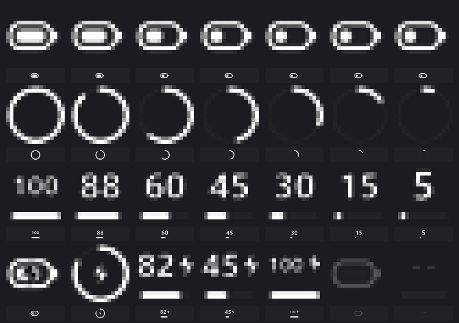

# ScyroxTray — SCYROX / Compx 无线鼠标电量托盘工具

按 [rapoo-tray](https://github.com/Iris-0109/rapoo-tray) 的思路（**HID 集合枚举 → 厂商报文解析 → 动态托盘图标 → OSD 悬浮窗**）为 **SCYROX（Compx）无线鼠标** 实现的 Windows 电量监视工具。

支持两代硬件，按上报的 VID/PID **自动识别，无需任何配置**：

| 世代 | 设备描述 | VID / PID | 报文 |
| --- | --- | --- | --- |
| 旧款（V6 / V8） | `SCYROX 8K Dongle` | `3554 / F5F7`（2.4G 8K）、`F5F6`（有线） | 16 字节（§2.2） |
| 新款（V6S / V8S） | `Scyrox Turbo 8k dongle`（接收器）、`Scyrox V6S`（有线） | `395A / 000E`（2.4G 8K）、`000B`（有线）、`000C` | 64 字节（§2.6） |

两代均在本机实测通过。新款的**有线与无线模式共用同一套协议**，程序会按当前枚举到的 PID 自动切换，无需手动指定。

* 纯 Win32 / .NET Framework 4.8 单文件程序（`ScyroxTray.exe`，约 58 KB），无第三方依赖、无需管理员权限。
* 协议对齐官方 S-Center（旧款）／ S-Center 2.0（新款）报文，并参考了开源实现
  [scyrox-v6-battery-plasmoid](https://github.com/mikezom/scyrox-v6-battery-plasmoid)、
  [scyrox (Rust crate)](https://github.com/azais-corentin/scyrox)、
  [ScyroxV8BatteryTray](https://github.com/jonathanaldo87-debug/ScyroxV8BatteryTray)。

| 任务栏里的实际效果（白色 45 + 底部进度条） | 三种样式 + 充电 / 无读数状态（上排放大 6 倍，下排为真实 16px 大小） |
| :---: | :---: |
|  |  |

---

## 1. 快速开始

```text
双击 bin\ScyroxTray.exe            # 启动，只驻留托盘，不弹任何窗口
```

* **鼠标悬停** 图标 → 提示 `SCYROX 45%`（充电时追加 `· 充电中`）
* **左键双击** 图标 → 立即刷新一次电量
* **右键** 图标 → 控制面板（立即刷新、图标样式、刷新间隔、低电量提醒、开机自启、复制诊断信息、退出）；
  已开启的选项（如“开机自启”“电量平滑”）左侧会显示**白色对勾**（默认勾选标记是深色，在暗色菜单里看不见，已自绘）
* 图标为**纯白**，与任务栏图标同色调；尚未拿到读数时是半透明白（禁用态）
* 每次刷新前，托盘一直显示**上一次读到的电量**（不显示任何“休眠/离线”字样）

### 图标绘制

三种样式（右键菜单切换）：

| 样式 | 说明 | 充电时的样子 |
| --- | --- | --- |
| **胶囊电池** | 横向圆角电池 + 按比例填充 + 右侧电极 | 电池内部显示深色闪电 |
| **环形电量** | 圆环进度弧（16px 下环内放数字会糊，所以不放数字） | 环心显示闪电 |
| **大号数字** | 百分比大字 + 底部圆角进度条 | 数字左移并略缩，右侧显示闪电 |

充电状态：旧款由 `0x04` 应答的 `byte7 == 1` 判定，新款由 `0x2E` 应答的 `[5] == 1` 判定；同时鼠标悬停提示会变成 `SCYROX 45% · 充电中`。

绘制方式：先在 **4 倍画布**上用抗锯齿画出全部笔画，再高质量缩放回 16×16。
16px 直接绘制必然出现锯齿和彩色描边，超采样后数字与圆角都干净，且与任务栏其它白色图标同色调。

> Windows 11 默认把新加入的通知图标放进「隐藏图标」弹层（任务栏那个 `^`）。把本程序的图标从弹层里**拖到任务栏**即可常显。

### 刷新策略

| 项 | 值 |
| --- | --- |
| 电量轮询间隔 | **10 分钟**（右键菜单可切 5 / 10 / 30 / 60 分钟），从**上一次成功读数**开始计时 |
| 在线状态轮询 | 1.5 秒（只问接收器，代价极低，用于判断此刻能否查电量） |
| 到点时鼠标在休眠 | 不查询（接收器转发不到），**等鼠标下次被唤醒后 1~2 秒内立刻补读**，仍然不会超过“10 分钟一次”的频率 |
| 查询无应答 | 15 秒后重试，直到成功；期间继续显示上一次读数，界面不提示任何状态 |
| 设备主动通知（`0x0A & 0x40` 电量变化） | 立刻补查一次 |
| 手动刷新 | 双击图标 / 右键“立即刷新” |
| 计时基准 | 用**单调时钟**（`Stopwatch`）而非系统时间，系统时间被校准/跳变也不会导致“到点不刷新” |

> 无线鼠标空闲约 10 秒即休眠，休眠期间接收器**无法**转发电量查询（`0x03` 在线查询仍会应答，但 `byte6 = 0`）。
> 因此程序只在“鼠标醒着 + 距上次成功读数已满 10 分钟”时才查询；一旦你碰鼠标，读数会在 1~2 秒内更新。

### 命令行模式

```text
ScyroxTray.exe --once              读取一次电量（文本）
ScyroxTray.exe --json              读取一次电量（JSON，便于脚本/状态栏调用）
ScyroxTray.exe --watch 5           持续监测，每 5 秒输出一行
ScyroxTray.exe --debug             打印完整 HID 报文（TX/RX 十六进制）
ScyroxTray.exe --log tray.log      托盘模式把协议日志写入文件
ScyroxTray.exe --style 0|1|2       设置图标样式并退出
ScyroxTray.exe --interval 600000   设置刷新间隔（毫秒，默认 600000 = 10 分钟）
ScyroxTray.exe --icon-preview icons.png   导出图标预览图（3 样式 × 各电量档）
```

实测输出示例：

```text
$ ScyroxTray.exe --json
{"connected":true,"level":60,"firmware_level":60,"voltage_level":67,
 "voltage_mv":3946,"charging":false,"sampled_at":"2026-09-25T13:58:48","raw":"08 04 00 00 00 02 3C 00 0F 6A 00 00 00 00 00 00 92"}
```

---

## 2. 协议还原（实测）

### 2.1 HID 集合选择

程序按 VID/PID 分两代处理，**优先匹配新款**（整台设备里只有它有 ≥17 字节的厂商集合）。

**新款（V6S / V8S）** — `VID=0x395A`，`PID ∈ {0x000E, 0x000B, 0x000C}`，取 `UsagePage = 0xFF00` 的 64 字节厂商集合：

```text
\\?\hid#vid_395a&pid_000e&mi_02&col03#...   UP=0xFF00 US=0x0002  in=64 out=64
```

该接收器同时暴露鼠标（`MI_00` 8B）、键盘（`MI_01&col01` 9B）、多媒体与系统控制等只读集合；
**只有 `MI_02&col03` 这一个集合可写**，且只接受 Report ID `0x08`（其它 Report ID 写入一律失败）。

**旧款（V6 / V8）** — `VID=0x3554` 且 `PID=0xF5F7`（无线 8K 接收器）/ `PID=0xF5F6`（有线），
取 **输入/输出报文长度均为 17 字节** 的厂商集合（设备路径含 `col05`）：

```text
\\?\hid#vid_3554&pid_f5f7&mi_01&col05#...   UP=0xFF02 US=0x0002  in=17 out=17
```

该接收器还暴露若干只读厂商集合（`col01` 8B、`col02` 8B、`col07` 49B）与一个 8 字节 Feature 集合（`col06`，只读设备信息 `06 00 00 64 64 64 CD 7B`，与电量无关）。

### 2.2 报文格式

主机 → 设备（首字节为 Report ID `0x08`，其后 16 字节）：

| 偏移 | 长度 | 含义 |
| --- | --- | --- |
| 0 | 1 | 命令 ID |
| 1 | 1 | 保留 / 参数 |
| 2–3 | 2 | Flash 地址高/低字节 |
| 4 | 1 | 数据长度 |
| 5–14 | 10 | 数据 |
| 15 | 1 | 校验和 = `(0x55 - sum(byte[0..14]) - 0x08) & 0xFF` |

设备 → 主机：`byte0=0x08`（Report ID）、`byte1=命令回显`、`byte2=状态(0=成功)`、`byte5=数据长度`、`byte6..=数据`、末字节=校验和（整包求和低字节 == `0x55`）。

### 2.3 用到的命令

| 命令 | 名称 | 说明 |
| --- | --- | --- |
| `0x01` | EncryptionData | 握手，4 随机字节 + 长度 8；应答含 CID/MID/连接类型（本机 `CID 3E / MID 02 / Type 05 = 无线 8K`） |
| `0x02` | PCDriverStatus | 注册“驱动已连接” `01` / 断开 `00` |
| `0x03` | DeviceOnLine | 轮询在线状态：`byte6 == 1` 表示鼠标已唤醒并与接收器通信；`byte7..9` 为设备地址 |
| `0x04` | BatteryLevel | 读电量：`byte6` = 电量%，`byte7` = 充电(1/0)，`byte8..9` = 电池电压 mV（大端） |
| `0x0A` | StatusChanged | 设备主动通知，`byte6 & 0x40` 表示电量变化 → 立即补一次 `0x04` |

实测报文（鼠标唤醒时）：

```text
TX 08 04 00 00 00 00 00 00 00 00 00 00 00 00 00 00 49
RX 08 04 00 00 00 02 41 00 0F 6E 00 00 00 00 00 00 89   → 65% / 未充电 / 3950 mV
RX 08 04 00 00 00 02 3C 00 0F 6A 00 00 00 00 00 00 92   → 60% / 未充电 / 3946 mV
RX 08 04 00 00 00 02 3C 00 0F 62 00 00 00 00 00 00 9A   → 60% / 未充电 / 3938 mV
```

### 2.4 关键坑：鼠标休眠

无线鼠标空闲约 10 秒即休眠，此时 `0x03` 仍由**接收器**应答（但 `byte6 = 0`），而 `0x04` 会**超时无响应**——因为电量必须由鼠标本体经 2.4G 链路回传。
因此本程序：

1. 先用 `0x01` 握手 + `0x02` 注册驱动状态，再以 1.5 秒间隔轮询 `0x03`；
2. 只有在线时才发 `0x04`（默认 5 秒一次，可调）；
3. 离线/休眠时保留**上一次成功读数**（写入注册表 `HKCU\Software\ScyroxTray`，重启程序后仍能显示）；
4. 收到 `0x0A & 0x40` 通知时立刻补读一次。

### 2.5 电量换算

* 主显示值 = 固件自报百分比（`byte6`），并做“每 10 秒最多变化 1%”的平滑（可关闭）。
* 悬浮窗同时给出电压与**曲线估算值**：优先用实测拟合放电曲线（`3089 mV→0% … 4193 mV→100%`，来自 120k 条真实放电采样），
  低于曲线下限时回落到 S-Center 原厂阈值表（`3050/3420/…/4110 mV` 分段插值）。
* 新款（§2.6）的 `0x2E` 应答**不含电压字段**，因此新款的电压恒为 0，显示值全部来自固件自报百分比。

### 2.6 新款协议（V6S / V8S）

新款接收器与旧款**完全不兼容**：报文由 16 字节变为 **64 字节**，校验位置与命令集也全部不同。
以下内容由官方 **S-Center 2.0**（网页版驱动 `gaming.scyrox.net`）前端逻辑还原，并逐条在真机上验证。

**报文格式**（主机 → 设备，总长 64 字节）：

| 偏移 | 长度 | 含义 |
| --- | --- | --- |
| 0 | 1 | Report ID，固定 `0x08` |
| 1..n | n | 命令 + 参数 |
| n+1..62 | — | 补零 |
| 63 | 1 | 校验和 = `(0x08 + sum(命令数组)) & 0xFF` |

即：校验和只累加 **Report ID 与实际命令字节**（不含补零），放在**最后一字节**。
旧款则是放在第 16 字节、用 `0x55 - sum` 算法 —— 这两个差异任缺其一，设备都不会解析主机报文，
只会把输出报告原样回送（表现为"响应里的数据全是零"，极易误判成设备未连接）。

**用到的命令**：

| 命令 | 名称 | 说明 |
| --- | --- | --- |
| `[1]` | 读 profile | 设备分多包推送 profile 数据块（编码内含 `battery_level`） |
| `[32]` `[42]` `[43]` `[49]` `[54]` | 配置读取 | 官方 S-Center 2.0 初始化序列所用 |
| `[46, 0, 3]` | **读设备状态（本程序采用）** | 一条即返回「电量 + 充电 + 连接」三合一 |

**`[46, 0, 3]` 应答解析**（响应同样 64 字节，含 Report ID 偏移）：

| 字节 | 含义 |
| --- | --- |
| `[0]` | `0x08`（Report ID） |
| `[1]` | 命令回显 `0x2E` |
| `[4]` | **电量 %** |
| `[5]` | 充电（1/0） |
| `[6]` | 是否与接收器连接（1/0） |

实测报文：

```text
TX 08 2E 00 03 00 … 00 39                        (checksum = 8 + 0x2E + 3 = 0x39)
RX 08 2E 00 03 32 01 01 03 00 03 00 08 00 00 0B 00 … 86
          └─电量 50%─┘└充┘└连接
```

校验自证：`8 + 0x2E + 3 + 0x32 + 1 + 1 + 3 + 3 + 8 + 0x0B = 0x86` ← 与末字节一致。

> **新款无需握手**：旧款的 `0x01` 握手 + `0x02` 驱动状态在新款上非必需，一条 `0x2E` 即可拿到全部状态，
> 因此程序对新款直接轮询，跳过握手阶段。有线（`PID_000B`）与无线（`PID_000E`）**协议完全一致**，实测报文逐字节同构。

---

## 3. 源码结构

```text
ScyroxTray/
├─ build.bat                 一键编译（调用系统自带 csc，无需安装 VS）
├─ res/app.manifest          DPI 感知清单
├─ src/Hid.cs                SetupAPI + hid.dll 枚举、重叠 I/O 读写（对应 rapoo-tray 的 device_manager.cpp）
├─ src/ScyroxProtocol.cs     旧款协议：报文构造/解析、校验和、电压曲线、平滑器
├─ src/ScyroxV2.cs           新款（V6S/V8S）协议：64 字节报文、校验、0x2E 状态解析
├─ src/BatteryService.cs     后台采集线程：发现 →（旧款握手）→ 在线/电量轮询 → 状态广播；按 PID 分派两代协议
├─ src/TrayApp.cs            托盘图标（3 样式动态绘制，纯白）、暗色右键菜单、注册表设置
├─ src/Program.cs            入口与命令行模式
├─ docs/                     截图
└─ bin/ScyroxTray.exe        编译产物
```

### 重新编译

```cmd
build.bat
```

或手动（本机无需安装 Visual Studio，.NET Framework 自带 csc）：

```cmd
"%WINDIR%\Microsoft.NET\Framework64\v4.0.30319\csc.exe" /target:winexe /platform:anycpu /optimize+ ^
  /codepage:65001 /win32manifest:res\app.manifest ^
  /r:System.dll /r:System.Drawing.dll /r:System.Windows.Forms.dll ^
  /out:bin\ScyroxTray.exe src\Hid.cs src\ScyroxProtocol.cs src\ScyroxV2.cs src\BatteryService.cs src\TrayApp.cs src\Program.cs
```

---

## 4. 设置项（注册表 `HKCU\Software\ScyroxTray`）

| 值 | 含义 |
| --- | --- |
| `IconStyle` | 0 胶囊电池 / 1 环形电量 / 2 大号数字 |
| `IntervalMs` | 电量轮询间隔（默认 600000 = 10 分钟） |
| `Autostart` | 是否开机自启（写 `HKCU\...\CurrentVersion\Run`） |
| `Smooth` | 是否启用 1%/10s 平滑 |
| `LowBatteryAlert` / `LowBatteryThreshold` | 低电量气泡提醒及阈值（10/15/20/30%） |
| `Cached*` | 上次成功读数缓存（休眠时继续显示） |

---

## 5. 排错

| 现象 | 原因与处理 |
| --- | --- |
| 电量长时间不变 | 鼠标休眠期间接收器拿不到电量。碰一下鼠标，1~2 秒内会自动补读（已修复：间隔按“上次成功读数”计时，不再被失败的查询推后） |
| **图标偶尔消失** | 三种原因，均已处理：① 右键「退出」误触 → 现在退出前会弹确认框；② **Explorer 崩溃/重启**会清空所有托盘图标 → 程序监听 shell 的 `TaskbarCreated` 广播并自动重新注册（已用“杀掉 explorer”实测通过）；③ 真崩溃 → 写入 `%LOCALAPPDATA%\ScyroxTray\error.log` 并**自动重启自身** |
| 图标在隐藏弹层里 | 那是 Windows 11 的图标收纳，不是消失。点任务栏 `^`，把图标拖到任务栏即可常显 |
| 双击图标后数字没变 | 鼠标当时处于休眠，程序拿不到新值，仍显示上次读数 |
| `--once` 返回 `鼠标处于休眠/离线状态` | 命令行为需要即时结果，会要求先唤醒鼠标 |
| 提示“无法打开 HID 设备” | 官方 S-Center 驱动可能独占该集合，退出官方软件后重试 |
| 有线模式下读不到 | 旧款：插好数据线（PID 变为 `F5F6`），若同时插线与接收器则有线优先。**新款：数据线直连电脑时 PID 变为 `000B`，程序自动切换，无需任何设置** |
| **新款充电时鼠标没反应** | 这是 V6S/V8S 的**固件行为**：Type-C 口插入任何线都会切到「有线模式」并关闭无线发射。插**充电头**（纯电源、无 USB 主机）时鼠标必然无响应；**想边充边用，就把充电线插到电脑 USB 口** —— 此时鼠标作为有线鼠标正常工作，电量与充电状态照样可读 |
| 拔线后鼠标仍未恢复 | 开关一次鼠标底部电源开关，或拔插一次接收器，重新建立链路即可 |
| 新款电量长时间停在同一个值 | 新款上报粒度较粗，且无电压字段可交叉验证。可用充电状态自检：插上充电线后 `charging` 应在数秒内变为 `true`（`--json` / `--debug` 可直接观察），能变即说明数据通道是活的 |
| 重复双击 exe | 单实例限制：静默退出，不会出现两个图标（静默是为了让看门狗/计划任务能随时拉起它） |
| 被安全软件/加速器清理掉 | 进程被外部结束，程序自身无法自救。可用 `install.ps1` 安装到 `%LOCALAPPDATA%\Programs\ScyroxTray` 并配合计划任务做看门狗 |
| 崩溃排查 | 未处理异常写入 `%LOCALAPPDATA%\ScyroxTray\error.log`（该文件不存在 = 没崩过） |

---

## 6. 免责声明

本项目为个人自用工具，与雷柏 / SCYROX / Compx 官方无关；协议信息来自对自有硬件的公开报文分析
（旧款对齐官方 S-Center，新款对齐 S-Center 2.0 网页版驱动的公开前端逻辑），
仅在自有设备上做只读查询（旧款 `0x01/0x02/0x03/0x04`，新款 `0x2E`），不写入任何设备配置。

---

## 7. 打包 / 换一台电脑

这个目录**本身就是可搬运的完整包**：编译好的 exe、全部源码、构建脚本、文档都在里面，
零第三方依赖，不需要 node / python / Visual Studio。整个文件夹约 300 KB。

### 三步装到新机器

```powershell
# 1. 解压到任意位置，进入目录
cd ScyroxTray

# 2. 一键安装（复制到用户目录 + 桌面快捷方式 + 启动）
powershell -ExecutionPolicy Bypass -File .\install.ps1

# 3.（可选）顺便打开开机自启
powershell -ExecutionPolicy Bypass -File .\install.ps1 -Autostart
```

安装脚本的参数：

| 参数 | 作用 |
| --- | --- |
| `-Dir "D:\Tools\ScyroxTray"` | 指定安装目录（默认 `%LOCALAPPDATA%\Programs\ScyroxTray`） |
| `-Autostart` | 写入开机自启（`HKCU\...\Run\ScyroxTray`） |
| `-NoShortcut` | 不建桌面快捷方式 |
| `-NoLaunch` | 装完不启动 |
| `-WhatIf` | 只打印会做什么，不实际执行 |

卸载：

```powershell
powershell -ExecutionPolicy Bypass -File .\uninstall.ps1
powershell -ExecutionPolicy Bypass -File .\uninstall.ps1 -PurgeSettings   # 连设置与日志一起删
```

### 脚本只动这三个地方

1. 安装目录（默认 `%LOCALAPPDATA%\Programs\ScyroxTray`）
2. 桌面快捷方式 `ScyroxTray.lnk`
3. `HKCU\Software\Microsoft\Windows\CurrentVersion\Run` 里的 `ScyroxTray` 值

**全部是当前用户范围，不需要管理员权限。**

### 关于开机自启的路径

自启项里存的是 **exe 的绝对路径**，所以：

* 移动了文件夹之后，重新跑一次 `install.ps1 -Autostart` 就会改指到新位置；
  脚本在**旧路径已经不存在**时也会自动改指过去。
* 如果旧位置还在（也就是这台机器上有两份安装），脚本**不会**抢走自启，
  只打印一行提醒——避免把另一份安装的自启弄坏。
* 同理，`uninstall.ps1` 只在自启项指向**本次要卸载的那个目录**时才删除它，
  停止进程时也只停安装目录里的那个实例。

### 重新编译

改过源码后双击 `build.bat` 即可（见第 3 节，用系统自带 csc，不用装 Visual Studio）。

### 新机器需要什么

* Windows 10 / 11（x64），**.NET Framework 4.8**（Win10 1809 以后系统自带）
* 一个 SCYROX 鼠标 —— 旧款（V6 / V8）：`VID_3554 / PID_F5F7`（`SCYROX 8K Dongle` 接收器），有线为 `PID_F5F6`；新款（V6S / V8S）：`VID_395A / PID_000E`（`Scyrox Turbo 8k dongle` 接收器），有线为 `PID_000B`
* 不需要管理员权限；官方 S-Center 软件若正独占该 HID 集合，需要先退出它
